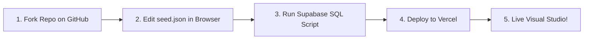

# Website Editor (`website-editor`)

> **Universal, plug-and-play website engine and visual drag-and-drop studio for service businesses with sub-second Realtime database sync.**

[](https://github.com/helloalifstudio-coder/Website-architecture)
[](https://github.com/helloalifstudio-coder/Website-architecture)
[](https://tanstack.com/start)
[](https://puckeditor.com)
[](https://supabase.com)
[](./LICENSE)

---

## 🎯 The Problem We Are Solving

Service businesses (agencies, clinics, legal firms, consultants, home services, logistics providers, and B2B specialists) face a painful digital dilemma:

| Traditional Static Websites | Legacy CMS Builders (WordPress / Wix / Webflow) | Headless CMS Platforms (Sanity / Contentful) |
|---|---|---|
| ❌ Rigid: Every text update, price change, or new service requires a software developer. | ❌ Bloated: Slow page speed, brittle plugins, recurring monthly software fees, and vendor lock-in. | ❌ Disconnected: Requires complex API plumbing, disjointed workflows, and no true inline visual editing for clients. |
| ❌ No client CMS panel. | ❌ Disconnected from PostgreSQL / CRM backends. | ❌ Expensive tier-based pricing for basic features. |

### The `website-editor` Solution

**`website-editor` is our first universal tool built to solve this across all service business industries.**

1. **Plug-and-Play DNA via `seed.json`**: The entire business identity (brand, theme colors, navigation, services, pricing, FAQs, and contact channels) is defined in a single file: `src/content/seed.json`.
2. **Dual-Deployment Architecture**:
   - **Public Website (`apps/public`)**: Ultra-fast edge delivery, optimized Core Web Vitals, and zero render crashes with automatic fallback protection.
   - **Visual Studio (`/builder`)**: An authenticated visual drag-and-drop canvas powered by Puck, allowing non-technical business owners to click, edit text, drag blocks, and publish live in milliseconds.
3. **Sub-Second Realtime Synchronization**: When an editor publishes in the studio, changes propagate across the globe via Supabase Realtime in under 100 milliseconds without requiring a code rebuild or redeployment.
4. **100% Code Ownership**: Your client owns their codebase, database, and customer pipeline with zero monthly platform subscriptions.

---

## 🧱 The 12 Universal Blocks System

Every service business can assemble world-class pages using our 12 universal, strictly typed, responsive blocks:

| # | Block Type | Capability | Inferred Visual Controls & Options |
|---|---|---|---|
| **1** | `hero` | High-impact conversion banner | Centered, split, and minimal variants; badge pill, primary & secondary CTAs, responsive media. |
| **2** | `featureGrid` | Core value propositions & benefits | Responsive 2, 3, or 4-column layout with automatic Lucide icon mapping. |
| **3** | `processFlow` | Step-by-step customer journey | Horizontal, vertical, and card timelines with auto-numbered step markers. |
| **4** | `serviceCatalog` | Filterable business capabilities | Interactive category filter pills, duration & price badges, feature bullet lists, and booking links. |
| **5** | `pricingTable` | Transparent plans & billing | Highlighted tiers, ribbon badges, feature checklists, and customizable CTA actions. |
| **6** | `testimonials` | Verified client social proof | Grid, carousel, or minimal layouts with star ratings, author roles, and company affiliations. |
| **7** | `statsBanner` | Verified impact & KPI metrics | Numbers, metric suffixes (`%`, `+`, `ms`), labels, and supporting subtext. |
| **8** | `accordionFaq` | Interactive question accordion | Accessible Radix accordion with smooth collapsible animations. |
| **9** | `leadCapture` | High-intent lead & contact form | Direct CRM pipeline capture with automated WhatsApp deep-link dispatch. |
| **10** | `contentSection` | Editorial & brand story sections | Alternating left/right media layouts with rich typography and bullet points. |
| **11** | `ctaBanner` | Closing conversion strip | Primary, dark, and card accent themes with prominent action buttons. |
| **12** | `logoCloud` | Client & partner brand carousel | Clean grayscale or brand-colored partner logo showcase. |

---

## 🚀 100% Online Setup Guide (No Local Coding Required!)

You can deploy a complete, client-ready dynamic website and visual editor entirely from your web browser in under 5 minutes without opening a terminal or cloning the repository locally.



### Step 1: Fork This Repository
1. Click the **Fork** button at the top right of this repository.
2. Select your GitHub account or agency organization as the owner.
3. Name your repository (e.g., `acme-consulting-website`).

### Step 2: Customize Your Business in `src/content/seed.json`
1. Inside your newly forked repository on GitHub, press the `.` (dot) key on your keyboard to instantly open the **GitHub Web Editor** in your browser.
2. Open [`src/content/seed.json`](./src/content/seed.json).
3. Update your company details:
   ```json
   {
     "site": {
       "brand": {
         "name": "Acme Legal Partners",
         "tagline": "Corporate & Commercial Legal Advisory",
         "description": "Specialized legal counsel for emerging technology enterprises.",
         "motto": "Clarity · Precision · Results"
       },
       "contact": {
         "whatsapp": "15551234567",
         "phone": "+1 555 123 4567",
         "email": "contact@acmelegal.com",
         "location": "Financial District, Suite 400"
       }
     }
   }
   ```
4. Commit your changes directly to the `main` branch.

### Step 3: Run the Database Installer in Supabase
1. Create a free account at [Supabase](https://supabase.com) and create a **New Project**.
2. In your Supabase project dashboard, click on the **SQL Editor** tab in the left sidebar.
3. Click **New query**.
4. Open [`supabase/setup-all.sql`](./supabase/setup-all.sql) from this repository, copy its entire contents, paste it into the Supabase SQL editor, and click **Run** (or press `Ctrl+Enter`).
5. *Done!* All tables, role-based security policies, Realtime publications, atomic publishing RPCs, and initial pages are now configured.
6. Copy your **Project URL** and **anon public key** from *Project Settings -> API*.

### Step 4: Deploy to Vercel (Dual-Deployment)
Import your forked repository into [Vercel](https://vercel.com):

#### Deployment A: The Public Website (Customer-Facing)
1. In Vercel, click **Add New... -> Project** and select your forked repository.
2. In the configuration screen, click **Edit** next to **Root Directory** and select:
   `apps/public`
3. Expand **Environment Variables** and add:
   - `VITE_SUPABASE_URL` = `https://your-project.supabase.co`
   - `VITE_SUPABASE_ANON_KEY` = `your-anon-public-key`
4. Click **Deploy**. Your blazing-fast public website is live!

#### Deployment B: The Visual Studio (Admin & Editing)
1. In Vercel, click **Add New... -> Project** and select the same repository again.
2. Leave **Root Directory** as the root (`.`).
3. Add the same Environment Variables:
   - `VITE_SUPABASE_URL` = `https://your-project.supabase.co`
   - `VITE_SUPABASE_ANON_KEY` = `your-anon-public-key`
4. Click **Deploy**. Your admin studio is live!

### Step 5: Grant Admin Access and Edit Live!
1. Open your live visual studio URL and navigate to `/auth`.
2. Sign up with your administrator email.
3. To grant yourself publishing privileges, open your Supabase **SQL Editor** and run:
   ```sql
   UPDATE auth.users
   SET raw_app_meta_data = raw_app_meta_data || '{"cms_role": "owner"}'::jsonb
   WHERE email = 'your-email@example.com';
   ```
4. Navigate to `/builder`. You can now drag blocks, click text to edit, and click **Publish**. Your public website updates globally in milliseconds!

---

## 🏛️ System Architecture

```text
┌────────────────────────────────────────────────────────┐
│                   src/content/seed.json                │
│     (Brand identity, Contact, Theme tokens, Pages)     │
└───────────┬────────────────────────────────┬───────────┘
            ▼                                ▼
┌──────────────────────────┐    ┌──────────────────────────┐
│  Public Website Engine   │    │    Puck Visual Studio    │
│      (apps/public)       │    │ (_authenticated/builder) │
│  • Edge CDN SPA          │    │  • Drag-and-drop blocks  │
│  • Dynamic CSS tokens    │    │  • Inline click-to-edit  │
│  • Bundled seed fallback │    │  • Revision history      │
└────────────┬─────────────┘    └────────────┬─────────────┘
             │                               │
             │   ◄── Supabase Realtime ───►  │
             │       (< 100ms sync)          │
             ▼                               ▼
┌────────────────────────────────────────────────────────┐
│                   Supabase PostgreSQL                  │
│    • Public published read RPC                         │
│    • Transactional versioned publishing RPC            │
│    • Role-based RLS: app_metadata.cms_role             │
└────────────────────────────────────────────────────────┘
```

---

## 💻 Local Development (For Developers)

If you prefer working locally:

### Prerequisites
- [Bun](https://bun.sh) (v1.3.14+)
- Node.js (v22+)

### Getting Started
```bash
# 1. Clone your repository
git clone https://github.com/helloalifstudio-coder/Website-architecture.git
cd Website-architecture

# 2. Install dependencies
bun install

# 3. Configure environment
cp .env.example .env
# Enter your VITE_SUPABASE_URL and VITE_SUPABASE_ANON_KEY

# 4. Start local development server
bun run dev
```

### Quality & Release Verification
Run the complete automated release verification gate:
```bash
# Execute unit tests (23/23 contracts)
bun test

# Execute strict TypeScript compilation check
bun run typecheck

# Build the public static edge bundle
bun run build:public

# Build the full Nitro SSR studio application
bun run build

# Run all checks at once
bun run check
```

---

## 📄 License

This project is licensed under the [MIT License](./LICENSE) — free for personal, commercial, and client agency use.
